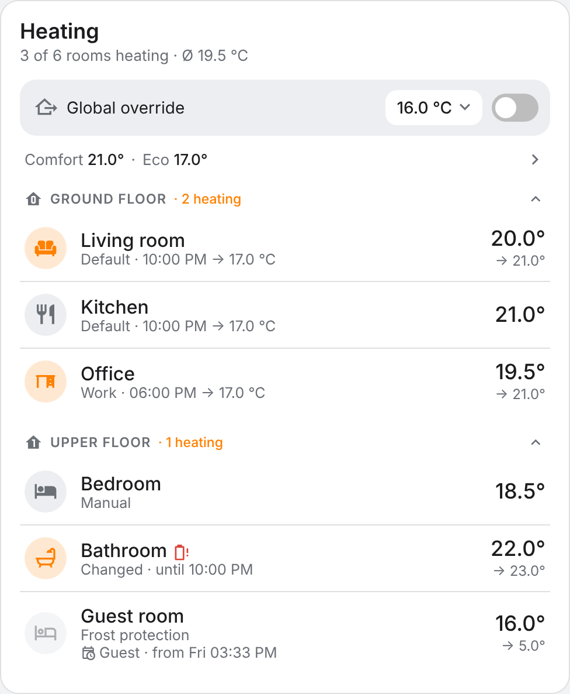
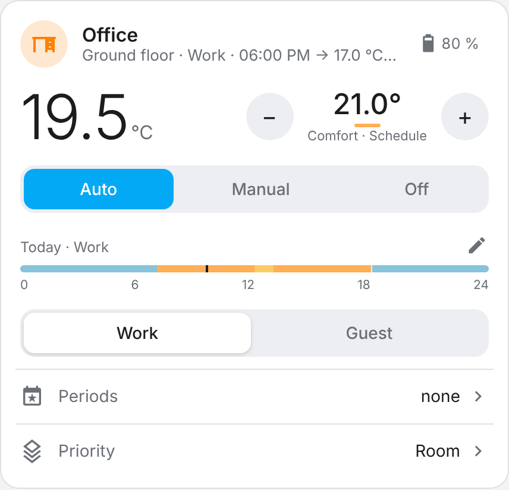
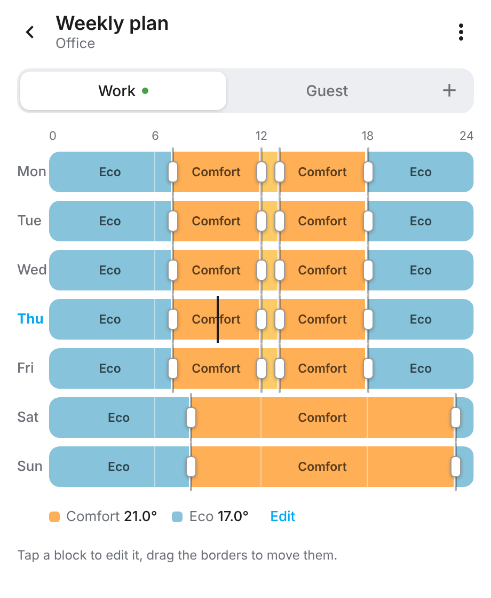
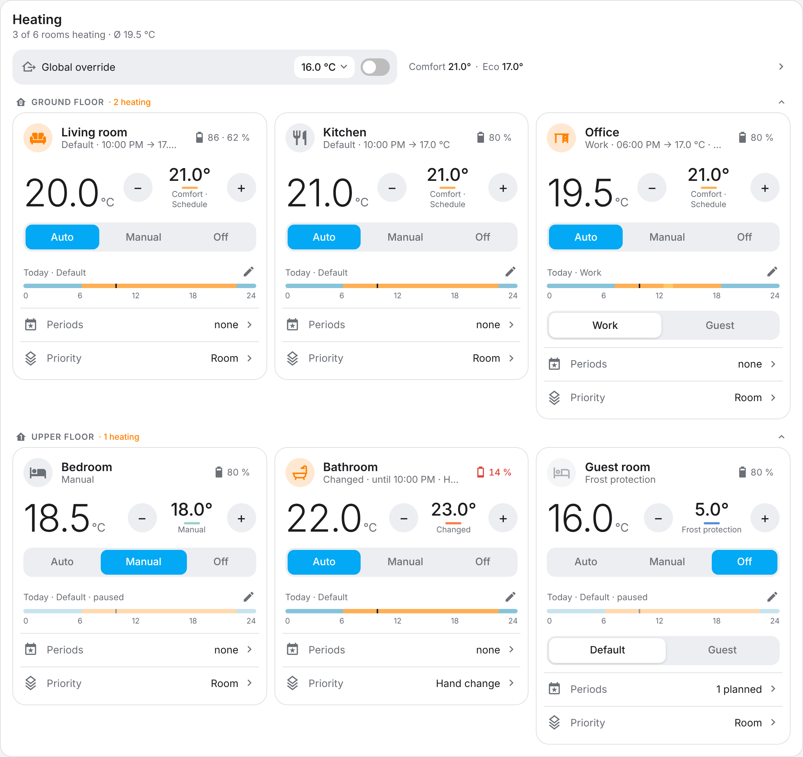

# Best Thermostat

*[English version](README.md)*

Raumbasierte Heizungssteuerung für Home Assistant. Du fasst die Heizkörperthermostate
eines Raums zusammen, gibst dem Raum einen oder mehrere Wochenpläne und steuerst alles
über zwei Dashboard-Karten. Alles läuft lokal und funktioniert mit jedem Thermostat, das
Home Assistant als `climate`-Entität bereitstellt (ZHA, Zigbee2MQTT, …).

  
  

Die Screenshots zeigen die englische Oberfläche; in einem deutschen Home Assistant ist
alles deutsch.

## Was du bekommst

- **Ein Thermostat pro Raum**, egal wie viele Heizkörperthermostate darin hängen. Alle
  werden synchron gehalten.
- **Wochenpläne** mit grafischem Editor. Ein Raum kann mehrere haben (z. B. „Arbeit“ und
  „Gäste“), umschalten geht mit einem Tipp.
- **Variablen** wie „Komfort“ und „Absenk“: Wert einmal ändern, alle Pläne folgen.
- **Globaler Override**, z. B. wenn niemand zu Hause ist. Nach dem Ausschalten ist alles
  genau wie vorher.
- **Zeiträume**: „Gästeplan von Freitag bis Sonntag“ oder „Bad drei Stunden auf 23 °C“.
  Danach läuft der Raum weiter wie zuvor.
- **Drei Modi** je Raum: *Auto* (Zeitplan), *Manuell* (feste Temperatur) und *Aus*
  (Frostschutz).
- Änderungen **direkt am Thermostat** werden erkannt und so behandelt, wie du es je Raum
  einstellst.
- Batteriestände, Stockwerke und Bereichs-Icons kommen automatisch aus Home Assistant.
- Deutsch und Englisch, passend zur Sprache von Home Assistant.

  

## Installation

1. HACS → ⋮ → *Benutzerdefinierte Repositories* →
   `https://github.com/zitroaen/bestthermostat`, Typ *Integration*.
2. „Best Thermostat“ installieren und Home Assistant neu starten.
3. *Einstellungen → Geräte & Dienste → Integration hinzufügen → Best Thermostat* und den
   ersten Raum anlegen: Name vergeben, Thermostate auswählen.
4. Dashboard bearbeiten, Karte hinzufügen und nach „Best Thermostat“ suchen. Es gibt zwei
   Karten: eine für einen einzelnen Raum und eine Übersicht aller Räume.

Die Karten werden automatisch registriert; eine Dashboard-Ressource musst du nicht
anlegen.

> **Wichtig:** Schalte interne Zeitpläne, Fenster-offen-Erkennung und Ähnliches direkt an
> den Thermostaten aus. Sonst verstellen sie die Solltemperatur selbst und arbeiten gegen
> die Integration.

## Erste Schritte

- **Zeitplan bearbeiten:** auf den kleinen Stift neben der Tagesleiste tippen. Einen
  Abschnitt antippen, um Zeit und Temperatur zu ändern, Grenzen ziehen, dann *Speichern*.
- **Temperatur ändern:** −/+ oder waagerecht über die Solltemperatur wischen.
- **Nicht zu Hause:** den Schalter *Globaler Override* in der Übersicht umlegen.
- **Besuch:** in der Raumkarte *Zeiträume* öffnen und einen Zeitraum planen.

Die Übersicht kann jeden Raum auch als Kachel zeigen, gut als Hauptansicht:

  

## Mehr

- **[Referenz](docs/reference.de.md)**: Entitäten, Raum- und globale Einstellungen,
  Priorität der Solltemperatur, Zeiträume und Kalender, Apple Home / Matter,
  Kartenoptionen und Services.
- **[Architektur](docs/architecture.md)** und
  **[Design-Entscheidungen](docs/decisions.md)** für Mitwirkende (englisch).

## Aktualisieren

Über HACS aktualisieren und Home Assistant neu starten. Offene Dashboards zeigen „Neue
Version der Karte verfügbar – Neu laden“; Neuladen genügt.

## Entwicklung

Siehe den Abschnitt *Development* im [englischen README](README.md#development) und
[CLAUDE.md](CLAUDE.md).

## Lizenz

MIT
