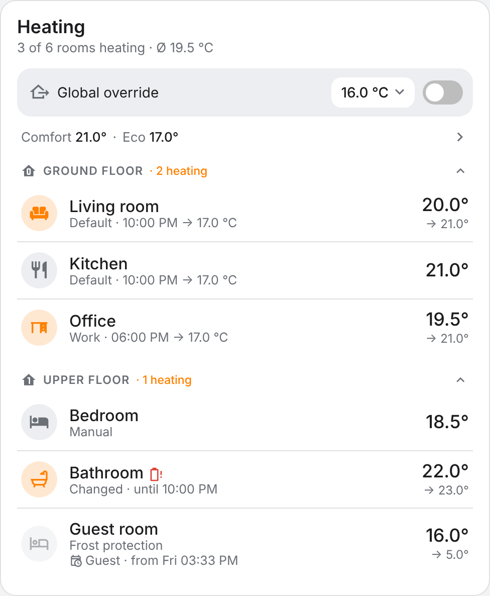
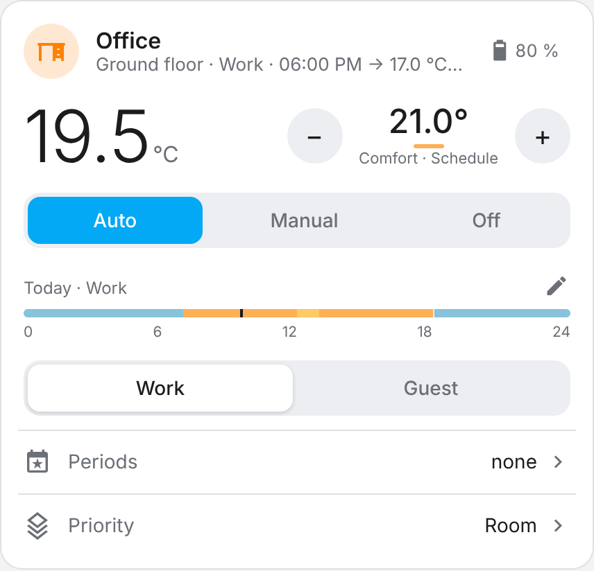
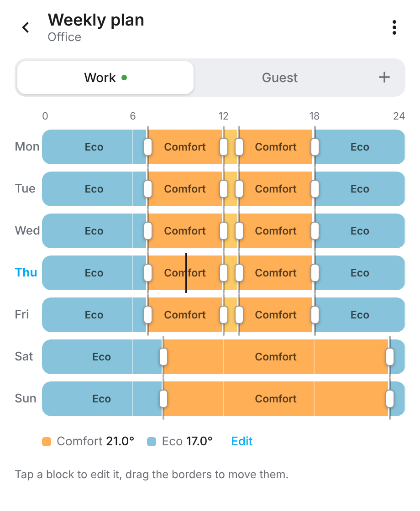
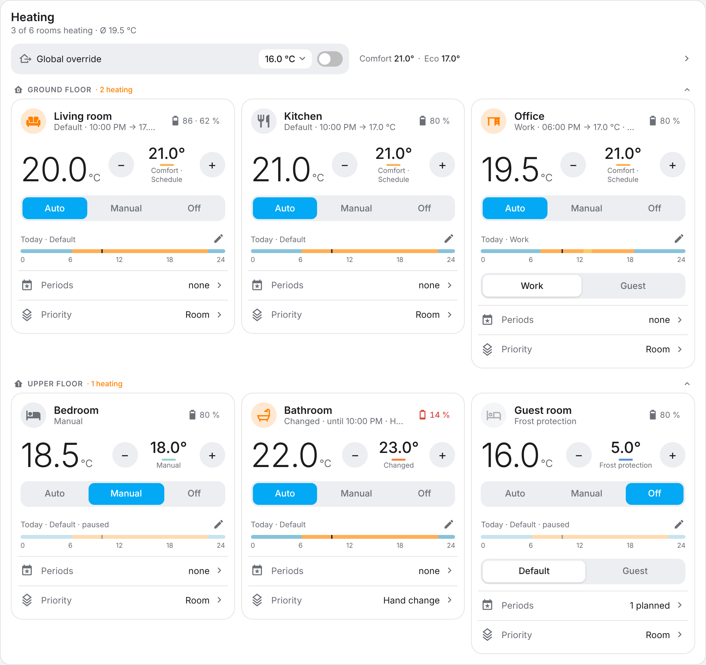

# Best Thermostat

*[Deutsche Version](README.de.md)*

Room-based heating control for Home Assistant. You group the radiator thermostats (TRVs)
of a room, give the room one or more weekly schedules and control everything from two
dashboard cards. It runs fully locally and works with any thermostat that Home Assistant
exposes as a `climate` entity (ZHA, Zigbee2MQTT, …).

<p align="center">
  
  
</p>

## What you get

- **One thermostat per room**, no matter how many TRVs are in it. All of them are kept in
  sync.
- **Weekly schedules** with a visual editor. A room can have several (e.g. "Work" and
  "Guest") and you switch between them with one tap.
- **Variables** such as "Comfort" and "Eco": change the value once and every schedule
  that uses it follows.
- **Global override**, e.g. while nobody is home. Turn it off and everything is exactly
  as before.
- **Periods**: "guest schedule from Friday to Sunday" or "bathroom at 23 °C for three
  hours". Afterwards the room continues as before.
- **Three modes** per room: *Auto* (schedule), *Manual* (fixed temperature) and *Off*
  (frost protection).
- Changes made **directly on a thermostat** are picked up and handled the way you choose
  per room.
- Battery levels, floors and area icons are taken from Home Assistant automatically.
- English and German, following the language of Home Assistant.

<p align="center">
  
</p>

## Installation

1. HACS → ⋮ → *Custom repositories* → `https://github.com/zitroaen/bestthermostat`,
   type *Integration*.
2. Install "Best Thermostat" and restart Home Assistant.
3. *Settings → Devices & services → Add integration → Best Thermostat* and create your
   first room: give it a name and pick its thermostats.
4. Edit a dashboard, add a card and search for "Best Thermostat". There are two cards:
   one for a single room and an overview of all rooms.

The cards are registered automatically; you do not have to add a dashboard resource.

> **Important:** turn off internal schedules, open-window detection and similar features
> on the thermostats themselves. Otherwise they change the set-point on their own and
> work against the integration.

## First steps

- **Edit a schedule:** tap the small pencil next to today's timeline. Tap a block to
  change its time and temperature, drag the borders to move them, then *Save*.
- **Change the temperature:** use −/+ or swipe sideways on the target temperature.
- **Away from home:** flip the *Global override* switch in the overview card.
- **Guests:** open *Periods* in the room card and plan a period.

The overview card can also show every room as a tile, which works well as the main
heating view:

<p align="center">
  
</p>

## More

- **[Reference](docs/reference.md)**: entities, room and global settings, priority of the
  set-point, periods and the calendar, Apple Home / Matter, card options and services.
- **[Architecture](docs/architecture.md)** and **[design decisions](docs/decisions.md)**
  for contributors.

## Updating

Update through HACS and restart Home Assistant. Open dashboards show "A new version of
the card is available – Reload"; a reload is enough.

## Development

```bash
pip install -r requirements_test.txt
ruff check . && mypy custom_components/bestthermostat && pytest

cd frontend
npm ci
npm run build         # writes custom_components/bestthermostat/frontend/bestthermostat-card.js
npm run demo          # preview the cards with fake data, no Home Assistant needed
```

See [CLAUDE.md](CLAUDE.md) for the conventions of this repository (it is written for AI
coding agents, but it is the shortest complete guide for humans too).

## License

MIT
